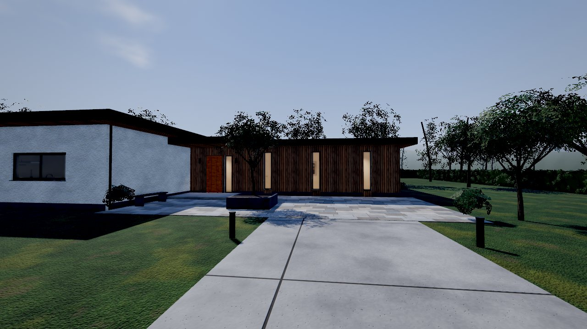
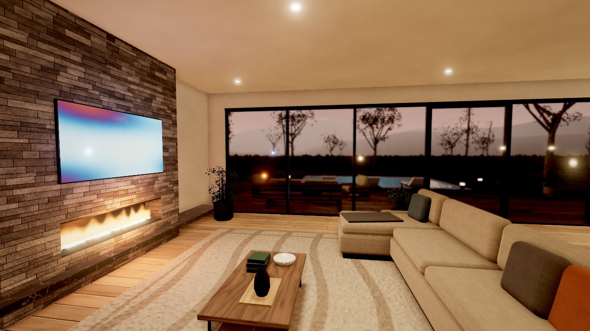
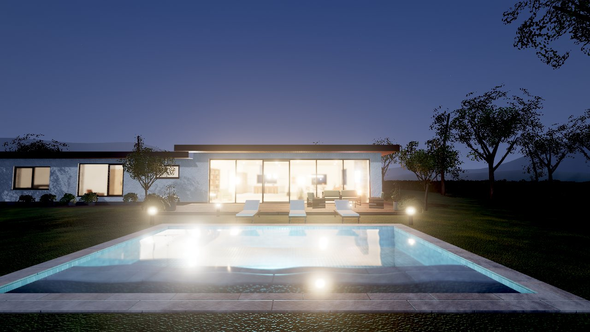
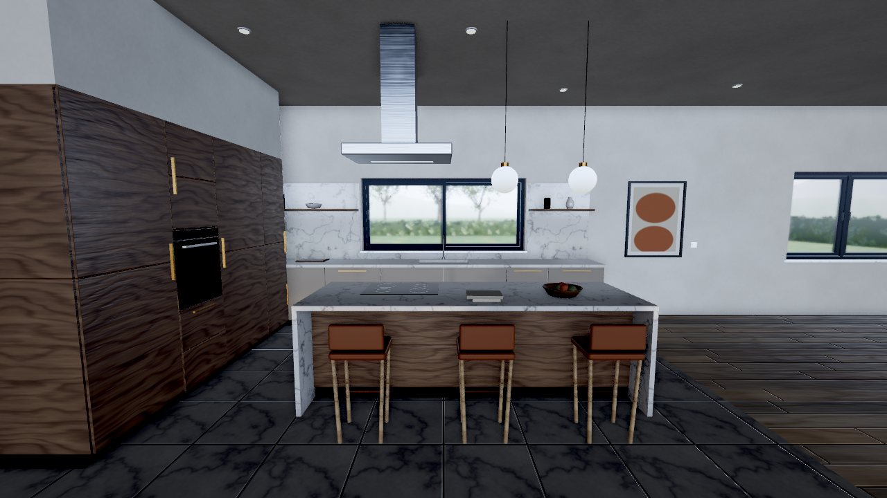
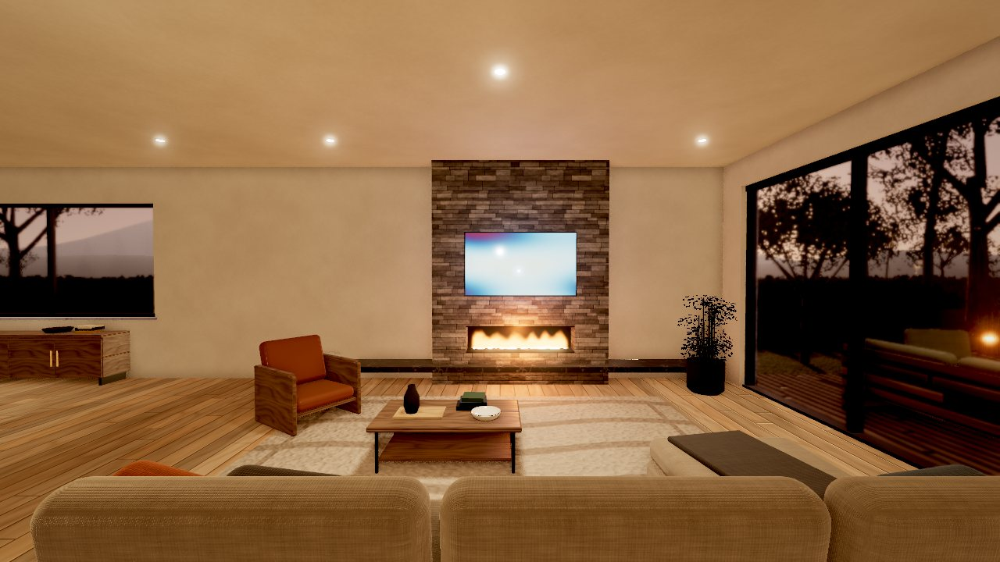
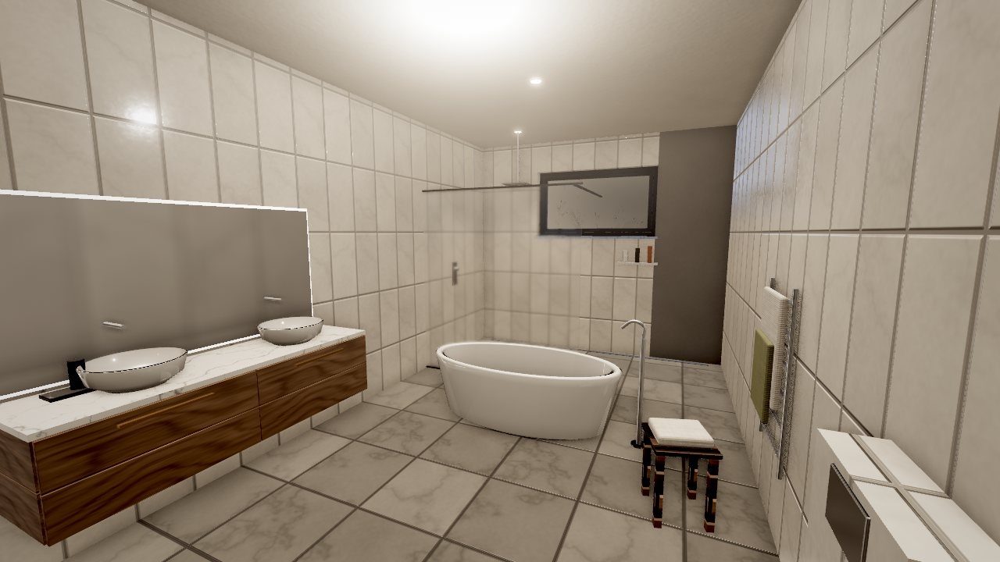
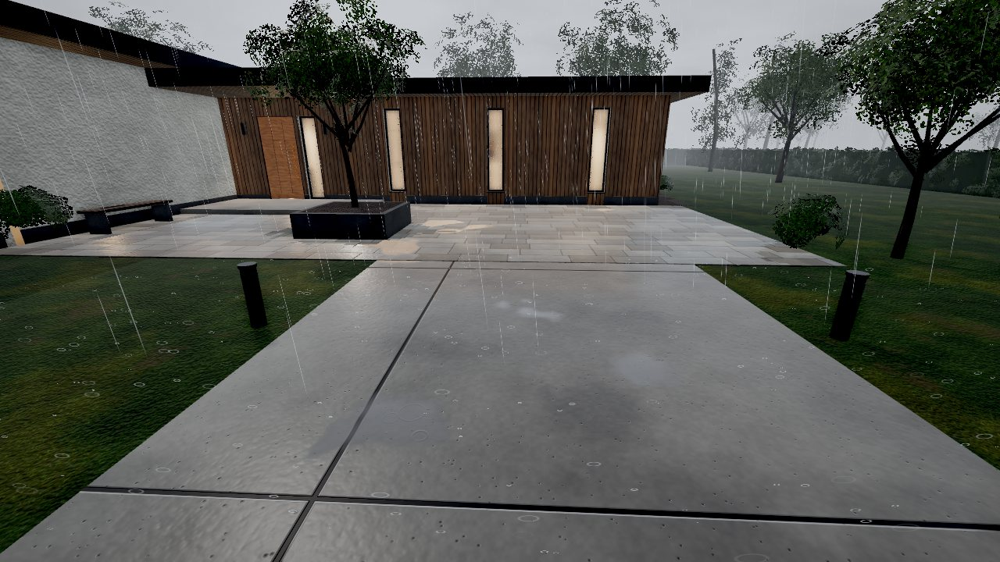
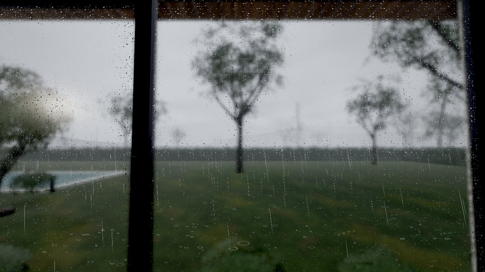
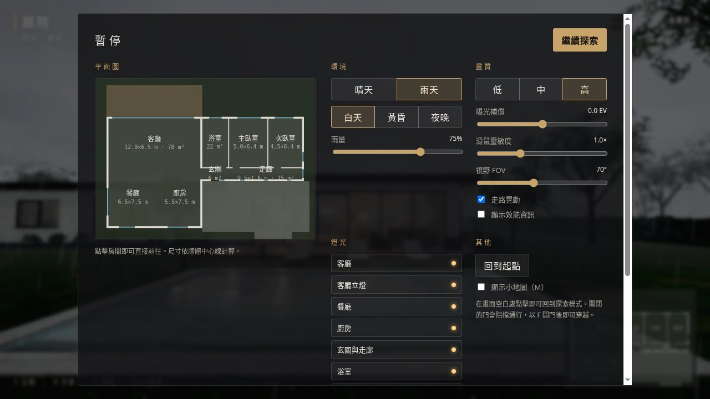

# 現代住宅 · 即時 3D 看房與探索

以 three.js（WebGL2）在瀏覽器中即時渲染的單層現代住宅。可用第一人稱自由走動、開關門窗與櫥櫃、控制各房間燈光、切換晴天 / 雨天與白天 / 黃昏 / 夜晚。所有建築、家具、植栽與材質貼圖都在載入時以程式生成，不需要任何外部模型或圖片，**完成下載後可完全離線執行**。

| | | |
|---|---|---|
|  |  |  |
|  |  |  |
|  |  |  |

---

## 1. 快速開始

瀏覽器不允許以 `file://` 直接開啟 ES 模組，因此專案附有一個**只監聽本機 (127.0.0.1)** 的小型網頁伺服器。它不需要網路，也不需要安裝任何套件。

### Windows
雙擊 **`start.bat`**。腳本會依序嘗試：

1. Python 3.7 以上（`python` 或 `py -3`）
2. Node.js 16 以上
3. 以上都沒有時，改用 Windows 內建的 PowerShell 伺服器（`serve.ps1`，不需系統管理員權限）

視窗會顯示網址（預設 `http://localhost:8765/`，若被占用會自動往後找可用連接埠）並自動開啟瀏覽器。關閉該視窗即停止伺服器。

### macOS / Linux
```sh
./start.sh            # 或： python3 serve.py   /   node serve.mjs
```
macOS 與大多數 Linux 發行版皆內建 Python 3。

### 執行環境需求
| 項目 | 需求 |
|---|---|
| 瀏覽器 | 支援 WebGL2 與 Import Maps：Chrome / Edge 89+、Firefox 108+、Safari 16.4+（開發測試使用 Chrome） |
| 顯示卡 | 支援 WebGL2 與浮點渲染目標（`EXT_color_buffer_float`）；需開啟瀏覽器「硬體加速」 |
| 啟動伺服器 | 以下任一：Python 3.7+、Node.js 16+、Windows PowerShell 5+（Windows 內建） |
| 操作裝置 | 鍵盤 + 滑鼠（觸控裝置會顯示提示，無觸控操作） |

> 專案**沒有**需要安裝的 npm 相依套件；`package.json` 只提供方便的指令（`npm start`、`npm test`）。

---

## 2. 離線執行

- three.js r186（`0.186.1`）已完整放在 `vendor/three/`，以 import map 載入，不使用任何 CDN。
- 沒有遠端圖片、模型、字型或 API；所有貼圖在啟動時以 Canvas 2D 生成，音效以 Web Audio 即時合成。
- 自動化測試中以 Chrome 封鎖所有非 localhost 的連線（模擬斷網），頁面載入共 65 個請求，**全部來自本機**（見第 8 節）。
- 專案不需建置步驟，`index.html` 就是正式版本；複製整個資料夾到另一台離線電腦即可執行。
- 若需更新 three.js 版本（需要網路一次）：`node tools/update-vendor.mjs 0.186.1`。

---

## 3. 操作方式

| 按鍵 | 功能 |
|---|---|
| 點擊畫面 / 「點擊開始探索」 | 進入場景並鎖定滑鼠（Pointer Lock） |
| `W` `A` `S` `D` | 移動（方向鍵亦可） |
| 滑鼠 | 轉動視角 |
| `Shift` | 加速 |
| `F` | 與注視中的物件互動（門、窗、燈、櫥櫃、抽屜、家電） |
| `E` | 進階操作：燈光調光（100% → 55% → 25%）、電視換頻道、壁爐火焰大小 |
| `R` | 晴天 / 雨天 |
| `T` | 白天 → 黃昏 → 夜晚 |
| `L` | 全屋燈光開 / 關 |
| `M` | 小地圖 |
| `B` | 回到起點 |
| `P` | 效能資訊（FPS、Draw calls、三角形數…） |
| `Esc` | 釋放滑鼠並開啟選單 |

**暫停選單**（按 `Esc`）：可點擊平面圖上的房間直接前往（平面圖標示各房間實際尺寸與面積）、切換天氣 / 時段 / 畫質、調整雨量、曝光補償、滑鼠靈敏度、視野、各房間燈光開關。設定會記在瀏覽器中（localStorage，失敗時不影響使用）。

---

## 4. 功能清單

### 已完成
**建築與空間（P0）**
- 單層現代住宅，公共區（客廳 78 m²、餐廳、廚房，挑高 3.3 m）與私密區（玄關、走廊、主臥室、次臥室、浴室，2.9 m）以不同屋頂高度區分。
- 牆體依門窗開口分段建模（真正的門洞與窗洞），外牆分內外兩半，窗台與窗框側壁分別使用室內 / 室外材質。
- 前院、車道、入口雨遮、後院木平台、泳池、草坪、樹籬、街道、遠山。所有房間互相連通，可由大門進入，經客廳落地推拉門走到後院。
- 1 單位 = 1 公尺；門高 2.1–2.4 m、走廊淨寬約 1.4 m、眼睛高度 1.65 m。

**第一人稱控制（P0）**
- Pointer Lock 滑鼠視角、WASD + Shift、加減速平滑、delta time 積分、斜向速度正規化、走路晃動（可關閉）。
- 垂直膠囊體碰撞（半徑 0.28 m、身高 1.78 m）：在平面上以圓形對牆體、家具、門板等「有高度範圍的旋轉矩形」做推出解算；移動依步長細分，避免高速穿牆；碰撞體以 2 m 網格分桶，每幀只檢查附近格子。低於 0.2 m 的物件（地毯、門檻、台階）可以跨越，地面高度以樓板矩形查詢，上下台階平滑。

**互動（P0 / P2）——共 61 個可互動物件**
| 類型 | 物件 |
|---|---|
| 門 (5) | 大門（外推）、浴室門、兩間臥室門（以門軸旋轉）、客廳落地推拉門（滑動） |
| 窗 (5) | 餐廳雙開窗、廚房橫拉窗、浴室上懸氣窗、主臥 / 次臥平開窗 |
| 燈光 (15) | 9 個牆面開關（含夜間定位小燈）、客廳立燈 ×2、主臥床頭燈 ×2、次臥檯燈 ×2；E 鍵調光 |
| 櫥櫃 / 抽屜 (31) | 廚房抽屜 12 個、水槽下櫃、洗碗機、食物櫃、烤箱（下翻門 + 內燈）、冰箱（含內部燈與層架）、高櫃、上櫃、餐櫃、浴櫃抽屜、床頭櫃、書桌抽屜、衣櫃（平開 / 拉門） |
| 家電 (5) | 壁爐（GLSL 火焰 + 閃爍光源，E 調整火焰）、電視（動態畫面 + 投射光，E 換頻道）、廚房水龍頭、淋浴、浴缸放水 |

- 統一的 Interaction Manager：畫面中心射線 + 每個物件自己的可互動距離；若牆或關閉的門擋在中間則不能互動；提示文字依狀態變化（例如「F 開啟大門」／「F 關閉大門」）。
- 動畫使用 three.js `AnimationMixer` 與緩動關鍵影格（Quaternion / Vector track），正播開啟、倒播關閉；動畫期間忽略輸入，按住 F 不會重複觸發。
- 門、窗扇、櫥櫃門、抽屜都有跟隨動畫的動態碰撞體：關門恢復阻擋、開門可通行、移動中的門會推開玩家；站在門口時不允許關門。

**渲染（P1）**
- PBR 材質（MeshStandard / MeshPhysical）：Base color、Roughness、Metalness、Normal、AO 貼圖；布料使用 Sheen、檯面與陶瓷使用 Clearcoat。
- 30 餘組 Canvas 2D 程式化貼圖：橡木地板、胡桃木、石材磁磚、浴室磁磚、大理石、灰泥、外牆粉刷、雪松木飾板、混凝土（含伸縮縫）、石板鋪面、層岩飾牆、戶外木平台、草地、布料、地毯、拉絲金屬、樹皮、葉片、礫石、柏油、泳池馬賽克、抽象畫作。全部為可無縫拼接的週期性雜訊，並另外加入大尺度變化以減少重複感。
- 日光（方向光 + PCF 軟陰影）與 27 盞室內外燈（點光源 / 聚光燈），4 盞主要房間燈具帶陰影。
- **間接光近似**：每個區域（公共區、走廊、浴室、兩間臥室）一個反射 / 輻照探針，以 CubeCamera 拍攝該區域後 PMREM 預濾波，作為該區材質的環境貼圖。探針會在開關燈、開關門、時段與天氣改變時重新拍攝（每幀最多一個區域），並保留上一次結果形成多次反彈，因此開燈後房間會整體變亮、夜晚室內外對比合理。
- 後處理鏈（EffectComposer）：HDR 場景 →（高畫質 4× MSAA）→ GTAO 環境遮蔽 → GPU 自動曝光（對數平均亮度、中央加權、明暗適應速度不同、部分適應）→ Unreal Bloom（閾值作用在曝光後的亮度，主要讓燈具與太陽泛光）→ ACES Filmic 色調映射 + 調色 + 暗角 + 抖色 → SMAA / FXAA（未開 MSAA 時）。
- 玻璃使用 transmission（折射取樣不透明場景），保留反射與高光；低畫質改為半透明玻璃以省下額外的渲染 pass。

**天氣與環境（P2）**
- GPU 雨：拉長的雨絲以 instancing 繪製、全部運動在頂點著色器，跟隨鏡頭循環；另有地面濺水。以俯視高度圖（場景頂視深度）遮擋，屋頂、雨遮與樹冠下不會下雨，室內也不會出現雨滴。雨量可在選單調整。
- 濕地面：依材質「吸水率」變暗並降低粗糙度；朝上的表面依雜訊遮罩逐漸積水，水窪接近鏡面、法線變平並帶雨滴漣漪；地面使用**受控的平面反射**（只在潮濕或靠近泳池時更新，解析度 0.33–0.5 倍、可隔幀更新），以 Fresnel 混合並依粗糙度取用模糊 mip。屋簷、雨遮、樹下的地面保持乾燥（同樣使用遮擋高度圖）。混凝土、石材、木平台、草地反應各不相同。
- 玻璃水珠：GLSL 程式化產生靜止水珠（會出現與蒸發）與向下滑動的水珠及水痕，直接取代玻璃的切線空間法線，因此同時影響折射取樣（真正扭曲玻璃後方畫面，水珠處加厚透鏡）與反射高光；起霧會提高粗糙度讓透射模糊，而水痕會擦出清楚的路徑。水珠位於玻璃自身的 UV 空間（公尺），窗扇開啟時會跟著移動。
- 時段：白天 / 黃昏 / 夜晚，天空著色器（漸層、雲、太陽 / 月亮、星星）、太陽方向與顏色、霧、環境光照全部連續混合；黃昏與夜晚自動開啟主要房間與戶外照明。
- 泳池：transmission 水面（體積衰減上色）+ 波浪 / 雨滴漣漪法線 + 平面反射；夜間水下燈。
- 戶外樹葉隨風擺動，下雨時風更強；雨聲（室內較悶）、開關與門窗音效由 Web Audio 合成。
- 天氣切換只改變參數與 uniform，不重建場景也不重新配置資源（自動測試驗證：反覆切換 7 次後幾何 / 貼圖數量不變）。

**介面與其他**
- 載入畫面（顯示每一步驟）、開始畫面、操作說明、互動提示、目前房間名稱與時段 / 天氣、畫質標籤、提示訊息、效能資訊、小地圖、暫停選單與可點擊平面圖、回到起點。
- 低 / 中 / 高三種畫質（見第 6 節），切換時保留玩家位置與所有物件狀態。
- WebGL2 不可用、缺少浮點渲染、以 `file://` 開啟、瀏覽器過舊、WebGL context 遺失等情況都會顯示明確的錯誤畫面而不是空白頁。

### 尚未完成 / 刻意未做
- 沒有觸控操作與手機版介面（開始畫面在觸控裝置上會提示需要鍵盤滑鼠）。
- 浴室鏡子使用反射探針近似，不是真正的平面鏡（真實鏡面需每幀多渲染一次場景，成本過高）。
- 窗簾為靜態；沒有門鎖、可移動的小物件或角色身體。
- 間接光是區域探針近似，不是即時全域光照（見第 7 節限制）。

---

## 5. 專案結構

```text
3d-house-walkthrough/
├── index.html               入口（import map、各畫面 DOM、早期錯誤處理）
├── start.bat / start.sh     啟動腳本
├── serve.py / serve.mjs / serve.ps1   本機伺服器（Python / Node / PowerShell，擇一）
├── package.json             npm 指令與 three.js 版本紀錄（無相依套件）
├── src/
│   ├── main.js              啟動流程、主迴圈、畫質 / 天氣 / 時段切換
│   ├── core/                rng.js（可重現亂數）、layers.js（渲染圖層）、audio.js（合成音效）
│   ├── scene/
│   │   ├── layout.js        平面配置唯一來源：牆、開口、門窗、房間、區域
│   │   ├── builder.js       靜態幾何合併（依材質 / 區域 / 陰影分桶）
│   │   ├── kit.js           家具建模工具（圓角盒、旋轉體、管線…）
│   │   ├── createHouse.js   牆、樓板、天花、屋頂、門窗組裝
│   │   ├── createInterior.js  燈具與開關、呼叫各房間模組
│   │   ├── interior/        living / kitchen（含餐廳）/ bedrooms / bathroom / hall / common
│   │   ├── createExterior.js  鋪面、泳池、戶外家具、庭園燈、遠景
│   │   ├── vegetation.js    程式化樹木、樹籬、灌木（instancing）
│   │   └── environment.js   時段 + 天氣：天空、太陽、霧、天空 IBL
│   ├── player/              controller.js（第一人稱）、collision.js（膠囊碰撞，無 three.js 相依）
│   ├── interaction/         interactionManager / animator / door / window / furniture / lighting
│   ├── rendering/           renderer / postprocessing / probes / planarReflection / quality / shaders/
│   ├── weather/             weatherSystem / rain / wetSurface / glassDroplets / water
│   ├── materials/           proceduralTextures.js（Canvas 2D 貼圖）、materialLibrary.js
│   └── ui/                  hud / settings（暫停選單）/ floorplan / style.css
├── vendor/three/            three.js 0.186.1（MIT）與本專案用到的 addons
├── tools/                   smoke-test.mjs、test-collision.mjs、cdp.mjs、update-vendor.mjs
└── docs/screenshots/        README 截圖
```

**相依套件**：只有 three.js `0.186.1`（MIT 授權，已附 LICENSE）。使用其中的 `EffectComposer`、`GTAOPass`、`UnrealBloomPass`、`SMAAPass`、`FXAAPass`、`RoundedBoxGeometry`、`BufferGeometryUtils`。沒有其他函式庫。

---

## 6. 畫質設定

| | 低 | 中 | 高 |
|---|---|---|---|
| 解析度倍率上限 | 1.0 | 1.0 | 1.5（HiDPI） |
| 抗鋸齒 | FXAA | SMAA | 4× MSAA（HDR 目標） |
| 環境遮蔽 GTAO | 關 | 半解析度 | 全解析度 |
| Bloom | 關（曝光併入最終 pass） | 開 | 開 |
| 日光陰影貼圖 | 1024 | 2048 | 4096 |
| 室內燈陰影貼圖 | 256 | 512 | 1024 |
| 折射玻璃 / 水 | 半透明替代 | 0.5 倍 | 0.75 倍 |
| 地面平面反射 | 關（只用環境貼圖） | 0.33 倍、隔幀 | 0.5 倍、每幀 |
| 雨絲 / 濺水數量 | 7k / 600 | 16k / 1.6k | 30k / 3k |

首次開啟會依 GPU 名稱預選畫質。為避免切換畫質時整批重新編譯著色器，帶陰影的燈數量與探針解析度在各畫質固定，只改變解析度與開關後處理。

---

## 7. 技術說明與限制（請先讀）

這是網頁上的即時渲染，以下效果都是「可行的近似」，**不是** Unreal Engine 的 Lumen / Nanite / 硬體光線追蹤：

- **全域光照**：以每區一個反射探針近似（見第 4 節）。探針位置固定在房間中央，因此反射有視差誤差、房間角落的間接光沒有方向性；燈具的直接光不會穿牆，但探針外的細部漏光 / 遮蔽靠 GTAO 補足。
- **曝光**採「部分適應」：白天的室內會比室外暗一些（真實相機與眼睛的感覺），窗外在室內會明顯過曝。可在選單調整「曝光補償」。
- **平面反射**只適用於 y = 0 的室外地面與泳池（泳池水面實際低 9 cm，有輕微誤差）；室內地板使用探針反射。
- **雨的遮擋**是場景載入時拍攝的一張俯視高度圖（約 12 cm 精度），開窗不會讓雨飄進室內。
- 前向渲染：27 盞燈會在每個像素計算，燈具數量再增加會直接影響效能。
- 第一次啟動需要編譯約 60 組著色器。在支援 `KHR_parallel_shader_compile` 的瀏覽器（Windows / macOS 的 Chrome、Edge 等）會平行編譯；在測試用的無頭 Linux Chrome 上約 3–4 秒、整體載入約 6 秒。

### 後續改善建議
1. 盒狀投影（box-projected）探針或更多探針，改善室內反射的視差與房間角落的間接光。
2. 聚集式（clustered）燈光或延遲渲染，讓燈具數量不再線性影響每個像素的成本。
3. 以 KTX2 / Basis 壓縮貼圖降低記憶體（需要建置步驟與 wasm 解碼器）。
4. 浴室真鏡面（僅在進入浴室時啟用的平面反射）。
5. 觸控 / 遊戲手把操作、窗簾開合、更多可互動小物件。
6. 在一般桌機（中階獨顯）與筆電內顯上實測並校準三種畫質。

---

## 8. 測試結果

### 自動化測試
- `node tools/test-collision.mjs`：碰撞核心單元測試 **12/12 通過**（推出、高速不穿牆、沿牆滑動、旋轉門板碰撞、高度範圍、牆角穩定、射線遮擋、樓板高度、空間網格）。
- `node tools/smoke-test.mjs`：啟動本機伺服器，以 Chrome（封鎖所有非 localhost 連線）載入專案，透過 DevTools Protocol 送出**真實鍵盤事件**操作。最近一次結果 **34/34 通過**：

| 編號 | 測試 | 結果 |
|---|---|---|
| A1 | 啟動完成，無錯誤畫面 | 通過（無頭 Chrome 約 6–15 秒，視 GPU 負載） |
| A2 | 沒有任何外部網路請求 | 通過（65 個請求皆為 localhost） |
| A5 | 整個測試過程沒有 JavaScript 錯誤 | 通過 |
| C1–C4 | W 前進（1 秒 2.4 m）、斜向不加速、Shift 約 2 倍、S / A | 通過 |
| C5–C7 | 外牆、室內隔間牆、家具碰撞 | 通過 |
| C8 | 隨機走動 40 次不穿地、不出現 NaN | 通過 |
| D1–D6 | 大門阻擋 → 注視提示 → F 開門（動畫中重複按鍵被忽略）→ 穿過 → 室內關門 → 恢復碰撞 | 通過 |
| D7–D8 | 主臥房門開啟並穿過狹窄門框 | 通過 |
| D9–D11 | 牆面開關實際改變燈光強度（0 → 40 cd）、E 調光、再按關燈 | 通過 |
| D12–D14 | 廚房抽屜開關（連按不錯亂）、冰箱門 | 通過 |
| D15 | 主臥平開窗 | 通過 |
| D16 | 落地推拉門開啟後走到露台 | 通過 |
| E1 | 雨天時雨絲 / 濕地面 / 玻璃水珠同步啟動 | 通過 |
| E2 | 時段切換 | 通過 |
| F1 | 視窗縮放（畫布與後處理緩衝同步） | 通過 |
| F2 | 反覆切換天氣不累積 GPU 資源（第一次雨天之後再切換 4 次，幾何 / 貼圖 / 著色器數量完全不變） | 通過 |
| F4 | 切換畫質後位置與門的狀態不變 | 通過 |
| B1–B2 | 房間名稱判定（9 個區域） | 通過 |

測試截圖存於 `tools/test-output/`（執行測試後產生），結果存於 `tools/test-output/results.json`。

### 效能（重要說明）
測試機為 Linux + 2×RTX 2080 Ti，但**測試期間兩張顯示卡同時被另一個大型語言模型推論服務占用**（GPU 使用率 35–63%、顯示記憶體約 96% 已被占用），因此以下數字明顯偏悲觀，**不代表一般中階顯示卡的表現**：

- 1920×1080、同步量測（每幀強制等待 GPU 完成）：低 ≈ 45 ms、中 ≈ 70 ms、高 ≈ 120 ms。
- 同一場景改為 960×540：低 ≈ 8.5 ms。解析度減半時間降 5 倍以上、移除所有燈光或陰影幾乎沒有差異，顯示瓶頸是被占用的顯示記憶體頻寬，而非場景本身的運算量。
- 每幀 Draw calls（高畫質，含 GTAO 法線 pass 與玻璃 transmission pass）：室內約 200–800、室外約 1100–1600，雨天加上平面反射約 2300–3200；場景約 38.5 萬個三角形、435 個 mesh。

**尚未在獨立、未被占用的中階顯示卡或內顯筆電上實測 60 FPS 目標**；請以畫質設定（`P` 鍵可看即時 FPS）自行調整。

### 未能實際測試的項目
- 真實滑鼠的 Pointer Lock 視角操作（無頭瀏覽器無法鎖定滑鼠；視角改以程式設定，鍵盤事件為真實事件）。
- Windows 的 `start.bat` / `serve.ps1`、macOS（開發環境為 Linux；腳本經人工檢查）。Python 與 Node 版伺服器已實際使用。
- Firefox、Safari（程式只使用標準 WebGL2 / ES 模組功能）。

---

## 9. 疑難排解

| 狀況 | 處理方式 |
|---|---|
| 顯示「請透過本機伺服器開啟」 | 你直接雙擊了 `index.html`。請改用 `start.bat` / `start.sh` 並開啟顯示的網址。 |
| 顯示「不支援 WebGL2」 | 開啟瀏覽器的硬體加速（Chrome：設定 → 系統 → 使用圖形加速功能），更新顯示卡驅動；遠端桌面或虛擬機常會停用 WebGL2。可到 `chrome://gpu` 確認。 |
| 畫面一直停在載入中、主控台出現 MIME type 錯誤 | 某些 Windows 的登錄檔把 `.js` 設成 `text/plain`。請使用本專案的 `serve.py` / `serve.mjs` / `serve.ps1`（已強制正確 MIME），不要用其他通用伺服器。 |
| 連接埠被占用 | 伺服器會自動嘗試 8765–8784；也可指定：`python serve.py --port 9000`。 |
| `start.bat` 開啟了 Microsoft Store | 那是 Windows 的 python 假捷徑；腳本會自動略過並改用 Node 或 PowerShell。也可安裝 Python 或在「應用程式執行別名」關閉它。 |
| PowerShell 提示執行原則 | `start.bat` 已使用 `-ExecutionPolicy Bypass` 只對這次執行生效；手動執行可用 `powershell -ExecutionPolicy Bypass -File serve.ps1`。 |
| 點擊後滑鼠沒有鎖定 | 瀏覽器規定按 Esc 離開後約 1 秒內不能再次鎖定，稍等後再點一次畫面。 |
| 很卡 | 按 `Esc` → 畫質選「低」；關閉其他占用 GPU 的程式；筆電請接上電源並使用獨立顯示卡。按 `P` 看 FPS 與 Draw calls。 |
| 室內太暗 / 太亮 | 選單中的「曝光補償」，或開燈（`L` 開全屋燈）。 |

---

## 10. 開發者工具

```sh
npm start                     # = node serve.mjs
npm run test:unit             # 碰撞單元測試（純 Node）
npm run test:smoke            # 端到端煙霧測試（需要 Chrome / Chromium；可設 CHROME_PATH）
node tools/smoke-test.mjs --gpu=swiftshader   # 沒有 GPU 時改用軟體渲染（很慢）
```

在網址後加上任何參數都不會改變行為；除錯時可在主控台使用 `__app`（例如 `__app.player.teleport(x, z, yaw)`、`__app.wet.debug.value = 1` 檢視濕地面反射項）。

授權：專案程式碼採 MIT；`vendor/three` 為 three.js（MIT，見 `vendor/three/LICENSE`）。
